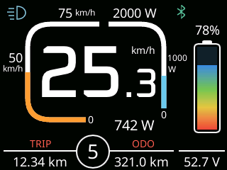
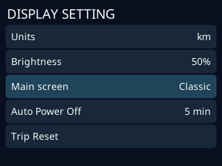
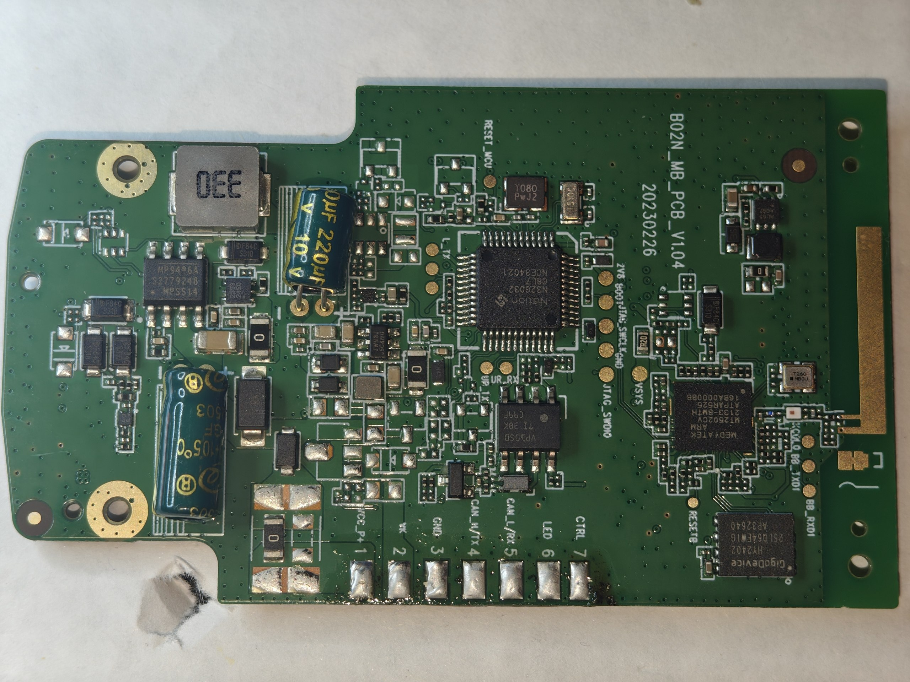
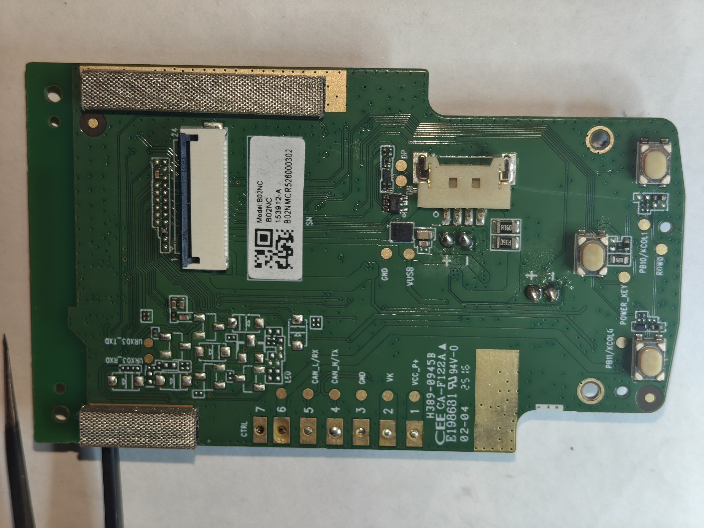

# EKD01 Rust Firmware

Experimental firmware for the Bafang EKD01 CAN-bus display, written in Rust without the MediaTek SDK.

Prototypes of all functions, including BLE, are implemented. The firmware has not been fully tested. The main screen layout still needs work. There are two main screen layouts. Both look bad.

Uses Embassy, Slint, Trouble and littlefs_rust. The auxiliary MCU firmware is left unchanged.

Tested on a display that originally ran `EKD01_CAN_BF_N22`. This may matter for compatibility: the auxiliary MCU firmware is not updated, and devices running other firmware versions have not been tested.

<p>
  
  
  
</p>

## Build

Install Rust through rustup. On Windows, install MSVC Build Tools and the Windows SDK.

```sh
cargo xtask build
```

The flash kit is generated in `target/flash-kit`, including the single MT2502 Embassy Boot loader.

## Flash

On Windows, install `drivers/windows/InstallDriver.exe`.

```sh
cargo flasher download --kit target/flash-kit
```

Start the command, then connect the display via USB with main power disconnected. The flasher selects the first newly appearing serial port.

By default, only the application is flashed and existing bootloaders are preserved. To install the new single Embassy Boot loader, replacing the original BL/EXT_BL boot path, use:

```sh
cargo flasher download --kit target/flash-kit --bootloaders
```

Booting through the custom loader has been tested on the N22 device. Update swapping and rollback still need hardware testing. The loader keeps the application at its original address and leaves settings and the auxiliary MCU unchanged. After installing it, `cargo flasher stage --kit target/flash-kit` writes an update to the spare slot. The next boot swaps it into place; the application confirms startup after its first LCD frame. An unconfirmed update reverts on the following boot. Direct `download` resets the rollback state after readback verification.

A bad firmware image can be recovered through the chip's built-in BootROM, even if the flash bootloaders are erased. Firmware flashing does not overwrite BootROM.

## BLE client

A Rust BLE telemetry client example is in [`ble-client/`](ble-client/). It has a desktop UI for scanning, connecting and viewing live telemetry.

```sh
cargo build-ble-client
cargo ble-client
```

Enable Bluetooth on the display, scan and connect. The client is read-only. On Linux, it uses BlueZ; building also requires `pkg-config` and `libdbus-1-dev`.

## EKD01 CAN PCB




